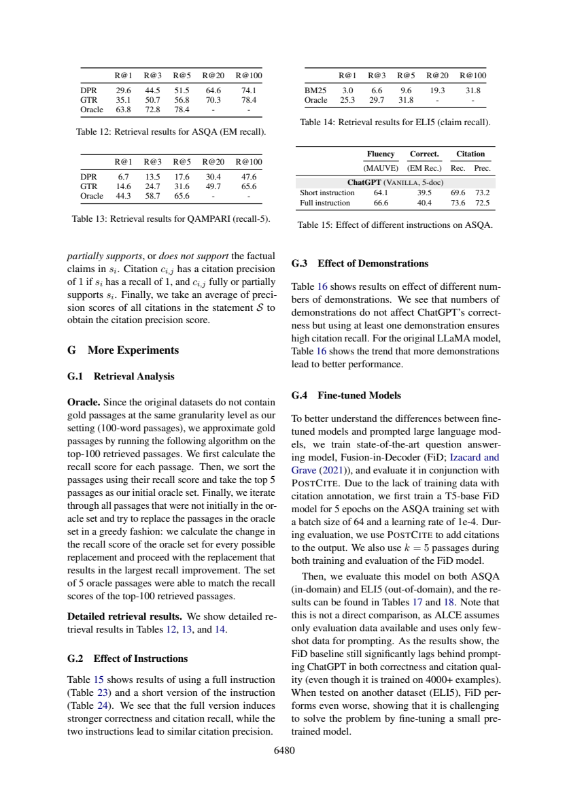

# 五篇Oracle段落为何能追平一百篇检索覆盖

这份分享解决一个具体的论文阅读问题，采用“先冻结问题与验收标准→编号原文→真实AI回答→严格定位→语义核查”的流程。范围、任务和作者判断在下文明确分开；不是对原论文实验的复现，也没有宣称模型、提示词或工作流普遍更优。此前我在同项目阅读过这两篇论文；本次主题与既有query位置、引用精度、recall-5等文章不同，实际调用也是新产生的。

## Oracle是带答案信息的诊断工具

ALCE附录G.1物理页16（6480）先说明：原数据没有本文100-word粒度的gold passages，因此在已检索top100中近似构造。流程是先算各段recall，排序取5段；再遍历未入初始集合的段落，尝试替换集合成员，按集合recall改进最大的替换贪心更新。作者报告最终5段能匹配top100的recall。原文没有给出完整伪代码、平局规则或“必须循环直到匹配”的停止条件，不能把结果倒写成算法保证。



|数据集与指标|原检索器R@100|Oracle R@5|
|---|---:|---:|
|ASQA EM recall，GTR|78.4|78.4|
|QAMPARI recall-5，GTR|65.6|65.6|
|ELI5 claim recall，BM25|31.8|31.8|

三个相等是各自任务内部比较，不是跨任务通用“答案覆盖百分比”。Oracle不生成新段落，也不搜索top100以外。它利用答案相关recall筛选，适合诊断阅读器在较好材料下仍丢失多少信息；真实线上问题未有gold答案时，不能直接计算同样的选择分。这不是部署时已可获得的五段检索器，也不是本文开发的新无标签算法。

Figure4物理页8（6472）对比top5 VANILLA与五段Oracle的生成正确性，二者通常落后对应检索覆盖，但正文明确有ELI5 top5例外。图注称retrieval recall为上界，应结合任务和支持材料的理想设定理解；模型可能靠参数知识作答，自动claim评估也有误差，因此不是所有生成器的数学硬上界。本文没有识别ELI5例外的唯一机制，也没有重跑逐题匹配。

## 原答核查：把观测结果改写成停止规则

D2的78.4/65.6/31.8及对应检索器正确，D3清楚披露标签依赖，D4保留ELI5例外。但D1说“迭代直到…匹配”，将报告结果升级成算法终止判据；来源只说明贪心替换过程和结果，不能保证任何候选池都存在五段达到同样覆盖。应写成“按最大改进贪心替换；本实验报告达到匹配”，缺失实现细节要保留。

D2 A-P16:43–46完整覆盖Table14，D4的A-P8:71–76也包含ELI5例外，定位可用；但D2额外引用Figure4只支持Oracle设置，不提供这三个具体数值，应以各表为准。机械范围校验只保证文本存在，不保证把限定条件一并取出。本例的阅读方法是先追踪答案标签流入哪里，再区分算法步骤、数据上的结果和部署可用性。没有新执行Oracle算法或保证五段普遍足够。

## 真实记录与复做

本次一轮Bohrium CLI2.8.1原生调用，请求gpt-5-mini/photon，实际返回chenkun/gpt-5-mini。无历史无工具，180秒预算，实际墙钟（含预检及客户端开销）27.256秒，输入3238、输出3801 tokens。completion ID见metadata；精确snapshot/temperature/seed不可得。费用无逐次货币信息，cost=null，不能当0。正文判断由Codex辅助非盲核查，不伪装独立人类评审。

完整[实际输入](run-request.txt)、[预检](run-preflight.json)、[原始响应](run-response.json)、[模型原答](run-output.json)、[元数据](run-metadata.json)、[stderr](run-stderr.txt)均保留。response仅脱敏私人余额。没有重写原答，也没有失败后挑选新答案。本次严格JSON/行范围结果为`ranges_valid`，共13段；这只检查id覆盖、字段存在与行范围，不检测问题语义对应、单位、蕴含或原文是否充分。

本地复查（Python3标准库、无需联网）：

```sh
python validate.py sources.json run-output.json
```

预期以validation.json为准；ranges_valid退出0，range_errors/invalid_json退出1，原始失败保留；请继续逐项比对[编号原文](numbered.txt)、正文审计与[调用前标准](criteria.md)。D1–D4标签存在不表示它们分别答对了问题。

独立重做需从玻尔官方渠道安装Bohrium CLI并手动登录，确保额度。保留这些文件同目录，用原生exe或对应系统原生二进制：

```sh
python replay.py --bohr /absolute/path/to/bohr --condition workflow --out new-run
```

replay先dry-run逐字验证实际message，再调用；现有out拒绝覆盖。Windows .cmd历史上会截断多行参数，原生exe避免这一已遇到的问题；命令行仍需低于Windows长度限制。若代理影响认证，本脚本仅移除子进程HTTP_PROXY/HTTPS_PROXY/ALL_PROXY及小写变量，不修改系统代理。真实输入含非语义UUID，新调用不保证逐字相同，按预先标准核验。失败记录不应删改，网络失败不得伪造成功。

## 文件导航与许可

[task.txt](task.txt)列出确切四项问题；[workflow.txt](workflow.txt)为本次方法；[protocol.md](protocol.md)为运行约束；[protocol-lock.json](protocol-lock.json)记录六个事前文件SHA256（对应本目录同名文件）。[sources.json](sources.json)保留原文页面、物理页和source_id，[SOURCES.md](SOURCES.md)说明作者、版本、页码、原PDF哈希与许可。图是原页核查材料，关键结论都另有文字，不依赖看图取数。

[validate.py](validate.py)是机械检查器；[replay.py](replay.py)保存全新请求与响应。只有本次输入输出进入本作品，未把旧实验重复包装。论文采用CC-BY4.0，原创文字与代码MIT。来源研究归论文作者；本次贡献是具体问题设计、适配编号流程、一次实际玻尔阅读、对原答缺陷的原文核查及可照做教程。
